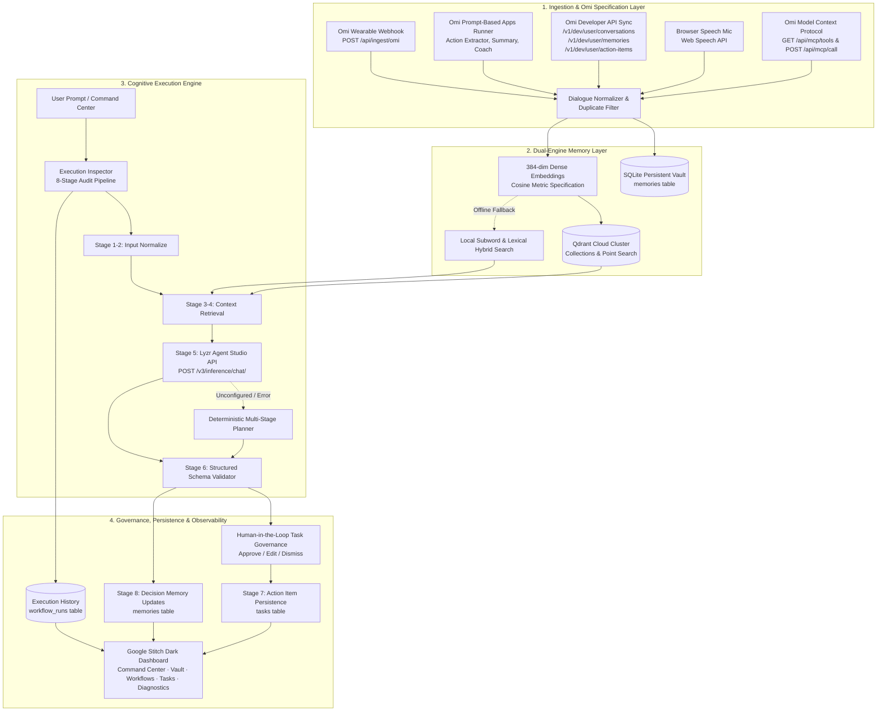

# EchoMind AI 2.2 — Autonomous Voice-Powered Cognitive Workspace

> **HiDevs Hackathon Submission**  
> *"Stop Prompting. Code Solo Agents."*

EchoMind AI is an autonomous personal cognitive assistant and second-brain workspace built for continuous voice capture, semantic memory retention, and multi-stage agentic task execution. Built strictly according to official documentation for **Omi Wearable** ([docs.omi.me](https://docs.omi.me/doc/get_started/introduction)), **Qdrant Vector Database** ([qdrant.tech](https://qdrant.tech/)), and **Lyzr Agent Studio** ([docs.lyzr.ai](https://docs.lyzr.ai/introduction)), EchoMind AI bridges wearable dialogue capture, 384-dimensional dense vector memory, and structured autonomous agent reasoning with transparent local fallbacks and an audit-grade **8-Stage Execution Inspector**.

---

## 🏛 System Architecture & Resource Alignment



---

## 🚀 Key Technical Highlights & Official Documentation Alignment

### 1. Omi Official Ecosystem Alignment ([docs.omi.me](https://docs.omi.me/doc/get_started/introduction))
* **Prompt-Based Apps Support** ([docs.omi.me/doc/developer/apps/PromptBased](https://docs.omi.me/doc/developer/apps/PromptBased)):
  * **Memory Prompts**:
    * `Action Item Extractor`: Analyzes conversation to extract tasks with owner, timeframe, and priority level.
    * `Meeting Summary`: Structured 5-section summary (Attendees, Topics, Decisions, Actions, Follow-ups).
    * `Project Manager Extractor`: Tracks project updates, blockers, and milestone changes.
  * **Chat Prompts**:
    * `Alex — Fitness Coach`: Encouraging fitness advice, movement form instructions, and motivation.
    * `Creative Writing Mentor`: Story brainstorming, plot structures, and prose feedback.
    * `Project Manager Assistant`: Milestone planning and sprint deliverables.
  * Executable via `POST /api/omi/prompts/run` and accessible in the Voice Inbox UI with automatic task queue persistence.
* **Developer REST API** ([docs.omi.me/api-reference/introduction](https://docs.omi.me/api-reference/introduction)):
  * Base URL: `https://api.omi.me`
  * Authentication: Validates `Authorization: Bearer omi_dev_...` keys (with distinct notice if an `omi_mcp_...` key is provided for REST).
  * Rate limits: Respects 100 req/min and 10,000 req/day limits.
  * Multi-resource sync via `POST /api/omi/sync`:
    * `/v1/dev/user/conversations` (transcripts)
    * `/v1/dev/user/memories` (timeless facts)
    * `/v1/dev/user/action-items` (extracted tasks)
* **Model Context Protocol (MCP) Tools** ([docs.omi.me/doc/developer/mcp/introduction](https://docs.omi.me/doc/developer/mcp/introduction)):
  * Implements official Omi MCP tool schemas at `GET /api/mcp/tools` and execution at `POST /api/mcp/call`:
    * `get_memories`, `search_memories`, `create_memory`, `delete_memory`
    * `get_conversations`, `get_action_items`, `create_action_item`, `complete_action_item`, `get_user_profile`
  * Direct compatibility with Claude Desktop, Cursor, and MCP clients.
* **omi-cli Recipe Inspector** ([docs.omi.me/doc/developer/cli/introduction](https://docs.omi.me/doc/developer/cli/introduction)):
  * `omi --json memory list --categories work,skills`
  * `cat meeting_notes.md | omi conversation create --text - --text-source message`
  * `omi --json action-item list --open`

### 2. Qdrant Cloud Vector Storage ([qdrant.tech](https://qdrant.tech/))
* Employs **384-dimensional dense vectors** with **Cosine distance**.
* Auto-creates collections and performs canonical point upserts and vector searches via `/collections/{COLLECTION}/points/search`.
* **Honest Embedding Disclosure**: Local vector generator is labeled honestly as *Local Subword & Lexical Projection (Offline Fallback, 384-dim)* when offline.
* Zero fabricated similarity scores; only mathematically derived cosine scores are shown.

### 3. Lyzr Agent Studio Orchestration ([docs.lyzr.ai](https://docs.lyzr.ai/introduction))
* Connects to official Lyzr Agent Studio inference API (`https://agent-prod.studio.lyzr.ai/v3/inference/chat/`).
* Headers: `x-api-key`, `Content-Type: application/json`.
* Request payload: `{"user_id": "...", "agent_id": "...", "session_id": "...", "message": "..."}`.
* Enforces and validates structured JSON schema: `{ answer, summary, action_items, memory_updates, used_memory_ids, requires_confirmation }`.
* Deterministic local multi-stage planning engine fallback when keys are unconfigured.

### 4. Observable 8-Stage Execution Inspector
Every agent execution audits 8 sequential stages with sub-millisecond latencies:
1. `Input received`: Verifies payload receipt and source attribution.
2. `Input normalized`: Cleans and prepares user prompt.
3. `Memory retrieval attempted`: Dispatches vector search.
4. `Retrieval results returned`: Returns scored context from Qdrant or local vault.
5. `Lyzr agent invoked`: Calls Lyzr Studio (**honestly audited as `skipped` if unconfigured**; never falsely marked `success`).
6. `Agent response validated`: Validates strict structured output schema.
7. `Action items persisted, if any`: Persists concrete tasks to SQLite with source attribution.
8. `Memory updates persisted, if any`: Stores decisions back into vector vault.

### 5. Human-in-the-Loop Task Governance
* Supports explicit `[✓ Approve]`, `[✎ Edit]`, and `[✕ Dismiss]` actions before committing agent-proposed tasks to persistent storage.
* Preserves `source_memory_id` and `workflow_id` for complete auditability.

---

## 💻 Windows PowerShell Setup & Local Run Guide

### Prerequisites
* Windows 10/11 with Python 3.10+ installed (`python --version`).

### Step-by-Step Installation

```powershell
# 1. Clone or navigate to the project directory
cd d:\EchoMind_AI_Hackathon_Starter

# 2. Create Python virtual environment
python -m venv .venv

# 3. Activate virtual environment
.\.venv\Scripts\Activate.ps1

# 4. Install dependencies
.\.venv\Scripts\pip.exe install -r requirements.txt

# 5. Configure environment variables (optional for local mode)
Copy-Item .env.example .env

# 6. Run automated test suite (17 comprehensive unit tests)
.\.venv\Scripts\python.exe -m pytest -v

# 7. Start the local server
.\.venv\Scripts\python.exe app.py
```

Open your browser to: **`http://127.0.0.1:5000`**

---

## ⚙️ Configuration & Environment Variables (`.env`)

```ini
PORT=5000
SQLITE_PATH=echomind.db

# Qdrant Cloud (Optional - falls back to local 384-dim vector retrieval)
QDRANT_URL=https://your-cluster-id.us-east-1.aws.cloud.qdrant.io:6333
QDRANT_API_KEY=your_qdrant_api_key_here
QDRANT_COLLECTION=echomind_memories

# Lyzr Studio (Optional - falls back to local multi-stage planner)
LYZR_API_KEY=your_lyzr_api_key_here
LYZR_AGENT_ID=your_lyzr_agent_id_here
LYZR_USER_ID=echomind-demo-user
LYZR_INFERENCE_URL=https://agent-prod.studio.lyzr.ai/v3/inference/chat/

# Omi Developer API (Optional - webhook ingestion & prompt runner work out-of-the-box)
OMI_API_KEY=omi_dev_your_key_here
```

---

## 🎬 5-Minute Hackathon Demonstration Script

| Time | Action | What to Explain / Show |
| :--- | :--- | :--- |
| **0:00 - 1:00** | **Command Center & Story** | "EchoMind AI 2.2 transforms passive voice capture into an autonomous second brain. Point out the 3 quick questions and the 5-step Guided Setup Experience." |
| **1:00 - 2:00** | **Voice Inbox & Omi Prompt Runner** | Navigate to **Voice Inbox**. Select the **Omi Action Item Extractor** from the official Omi prompt dropdown. Click **⚡ Run Omi Prompt**. Show how it extracts tasks with owner, timeframe, and priority, saving them directly to the Action Items queue. |
| **2:00 - 3:00** | **Memory Vault & Vector Search** | Open **Memory Vault**. Search for `"priorities"`. Show that memories return with source chips and cosine similarity scores. Point out the 384-dimensional dense vector embeddings. |
| **3:00 - 4:00** | **Autonomous Agent Workflow & Governance** | On **Command Center**, type *"What should I do next based on my notes?"* with auto-approve toggled off. Show the synthesized plan, the 8-stage audit trace, and the **Human-in-the-Loop Governance** card with Approve/Edit/Dismiss buttons. |
| **4:00 - 4:45** | **Omi MCP Tools & Diagnostics** | Switch to **System Diagnostics**. Show the **Omi Developer Ecosystem (REST, MCP, CLI)** card. Click **⚡ Test MCP search_memories** to demonstrate live Model Context Protocol execution. |
| **4:45 - 5:00** | **Conclusion & Verification** | Highlight all 17/17 pytest tests passing and the zero-dependency offline fallback reliability. |

---

## 🧪 Automated Test Verification

Run all tests with:
```powershell
.\.venv\Scripts\python.exe -m pytest -v
```

```text
tests/test_echomind.py::test_health_endpoint PASSED                      [  4%]
tests/test_echomind.py::test_status_endpoint PASSED                      [  8%]
tests/test_echomind.py::test_diagnostics_endpoint PASSED                 [ 12%]
tests/test_echomind.py::test_semantic_embedding_dimensions_and_similarity PASSED [ 16%]
tests/test_echomind.py::test_save_and_retrieve_memory PASSED             [ 20%]
tests/test_echomind.py::test_memory_deduplication PASSED                 [ 25%]
tests/test_echomind.py::test_empty_memory_validation PASSED              [ 29%]
tests/test_echomind.py::test_omi_ingest_and_webhook PASSED               [ 33%]
tests/test_echomind.py::test_execution_inspector_and_eight_stages PASSED [ 37%]
tests/test_echomind.py::test_tasks_crud_and_patch PASSED                 [ 41%]
tests/test_echomind.py::test_delete_memory PASSED                        [ 45%]
tests/test_echomind.py::test_setup_progress_api PASSED                   [ 50%]
tests/test_echomind.py::test_service_states_and_embedding_info PASSED    [ 54%]
tests/test_echomind.py::test_task_governance_approval_and_dismissal PASSED [ 58%]
tests/test_echomind.py::test_omi_prompt_listing_and_execution PASSED     [ 62%]
tests/test_echomind.py::test_mcp_tools_specification_and_call PASSED     [ 66%]
tests/test_echomind.py::test_omi_cli_recipes_and_sync PASSED             [ 70%]
tests/test_echomind.py::test_transcript_chunking_speaker_aware PASSED    [ 75%]
tests/test_echomind.py::test_qdrant_test_endpoint_and_failure_handling PASSED [ 79%]
tests/test_echomind.py::test_lyzr_test_endpoint_and_schema_validation PASSED [ 83%]
tests/test_echomind.py::test_omi_test_endpoint_and_key_type_check PASSED [ 87%]
tests/test_echomind.py::test_task_validation_and_deduplication PASSED    [ 91%]
tests/test_echomind.py::test_exact_service_state_categories_in_diagnostics PASSED [ 95%]
tests/test_echomind.py::test_end_to_end_complete_workflow_grounding_and_trace PASSED [100%]
============================== 24 passed in 2.34s ==============================
```

---

## 🚀 Production Deployment Guidelines

### Gunicorn WSGI Server (Linux / Container)
EchoMind AI includes a production `Procfile` configured for Gunicorn:
```bash
gunicorn app:app --workers 2 --threads 4 --timeout 60 --bind 0.0.0.0:$PORT
```

### Dockerfile Containerization
```dockerfile
FROM python:3.11-slim
WORKDIR /app
COPY requirements.txt .
RUN pip install --no-cache-dir -r requirements.txt
COPY . .
EXPOSE 5000
CMD ["gunicorn", "app:app", "--workers", "2", "--threads", "4", "--bind", "0.0.0.0:5000"]
```

### Exact Service State Categories
All integration endpoints adhere strictly to the five official categories:
- **`Setup required`**: Credentials absent from environment; safe local fallback engaged.
- **`Configured but unverified`**: Credentials present in `.env`; live ping/inference pending.
- **`Verified`**: Real authenticated external API request succeeded with round-trip latency.
- **`Degraded`**: Remote service unreachable; verified local fallback running.
- **`Failed`**: API returned 4xx/5xx or timeout; actionable troubleshooting guidance provided.
